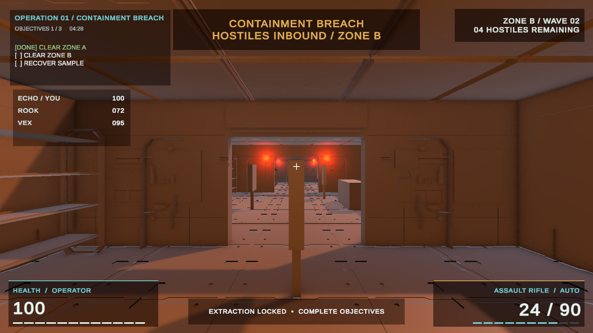

# M10 Stage C review — combat HUD and danger zones

This branch implements the owner's approved [cinematic HUD direction](https://github.com/Jadeni77/ArcadeShooter/pull/14) on the existing uGUI components. It is independent of [Stage B menu/lobby PR #15](https://github.com/Jadeni77/ArcadeShooter/pull/15) and targets `develop` for a separate review. The existing weapon, health, zone, mission, and network systems still supply all gameplay state.

## What changed

- Health and ammunition became compact lower-edge readouts with tick strips, explicit numeric values, reload text, and critical-health color plus text.
- The objective list and a small squad-health panel occupy the upper left. Health comes from each spawned player's replicated `PlayerHealth`; names come from a sanitized cosmetic `NetworkPlayer` value, sent by its owner once when it spawns.
- The extraction tracker sits at the bottom center, leaving the crosshair clear. Zone warnings and clear/failure notices enter with a short fade; active wave and enemy counts use a compact upper-right tracker.
- The UI reads the same events and properties as before. The pre-existing hit confirmation, damage flash, and result logic remain connected. `TeammateHud` skips polling while its owner Canvas is disabled and updates at most every 0.25 seconds when shown.

## Unity visual check

This PNG is rendered by Unity from the changed HUD builders over the actual `FirstPersonTest` scene. The camera sits at the saved player spawn. Objective, squad, and wave text are representative values injected for an Edit-mode layout check; this is **not** a live match screenshot. The scene currently has a placeholder-level appearance, so final HUD judgment also needs a real mission run with active encounter lighting and weapon viewmodel.

The batch Editor renderer displayed every panel but omitted TextMesh Pro glyphs when the render target used a 16:10 ratio, including at 1440×900 and 2560×1600. That capture failure does not establish the Game-view result. Check 1280×720, 1920×1080, 2560×1440, and a 16:10 Mac Game view in Play mode before accepting layout. The preview script remains in `Assets/Editor/M10HudPreview.cs` so the 16:9 image can be reproduced; its test labels are explicit.

## Verification and open checks

- Unity 6000.6.5f1 imported and compiled the changed code without a new C# error. Full EditMode regression: 44/45 passed; only the existing M8B batch-mode audio mixer parameter assertion failed, as it did in M9 and Stage B.
- On two clients, verify player names, health changes, late squad presence, dead-player text, warning-to-wave-to-clear transitions, reload and hit feedback, extraction state, and owner-only HUD visibility.
- Profile Canvas rebuilds and UI rendering during combat before claiming any frame-rate target. This branch has no Unity cloud link and has not run a Relay session.
